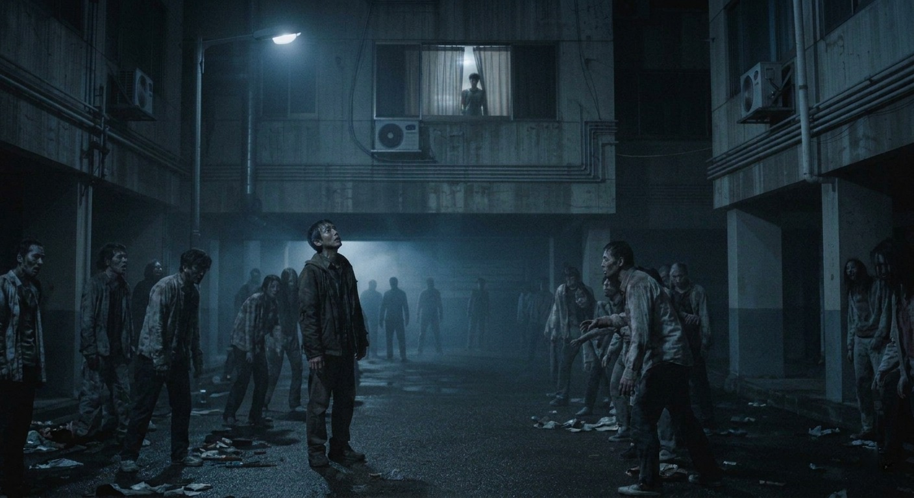
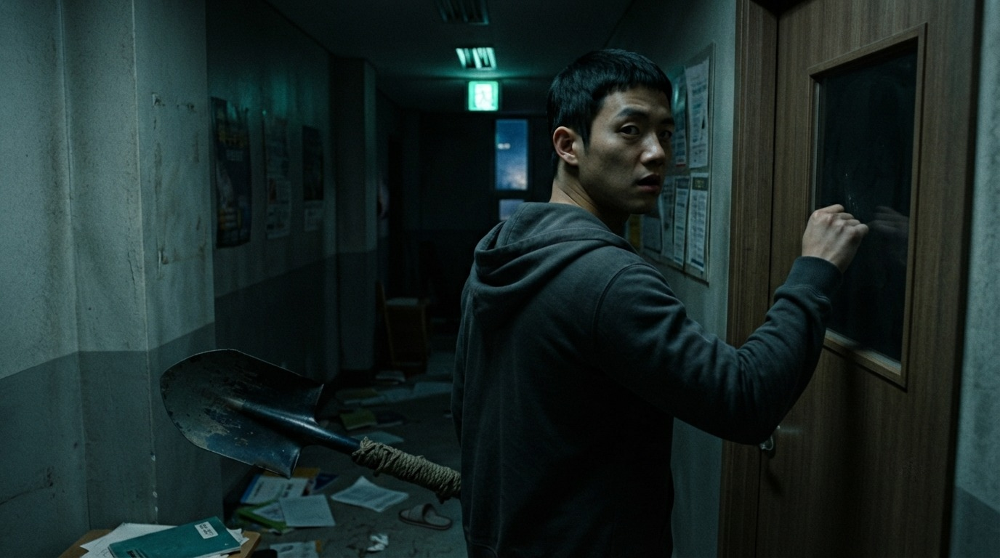
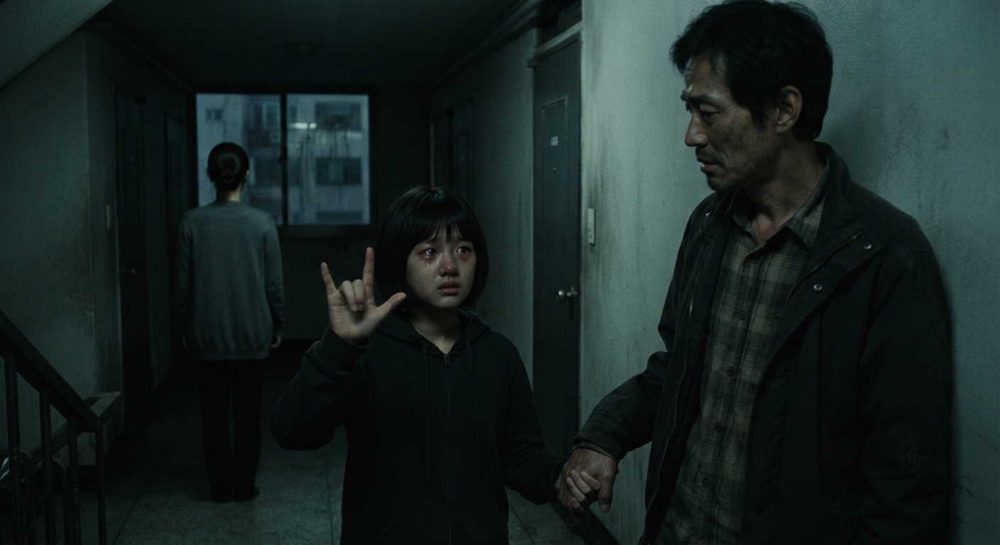
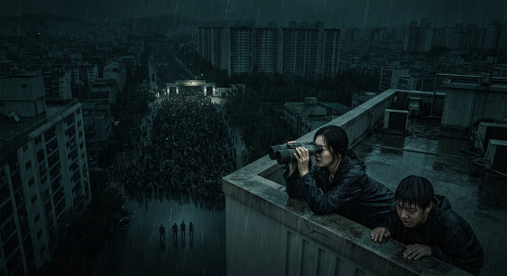

# 짧게 두 번, 길게 한 번

> 그 소리가 들리면, 문을 열어도 된다.



**한국 도시 좀비 연재소설 · 1편 완결**

퇴근길 2호선에서 시작된 재난. 정전된 서울, 늦가을의 아파트 단지 '세이프힐'. 대학생 지훈은 가족과 여자친구를 지키기 위해, 그리고 문 너머에서 들려오는 수많은 목소리 앞에서 매번 같은 질문을 마주한다.

**이 문을, 열 것인가.**

---

## 작품 소개

어린 시절 형제가 정한 노크 신호, **짧게 두 번, 길게 한 번.** 무서운 꿈을 꾼 동생이 형의 방문을 두드리던 그 신호는, 세상이 무너진 뒤 한 가족의 암호가 되고, 이윽고 스물일곱 명이 함께 사는 아파트 한 동의 규칙이 된다.

이 소설은 좀비에게서 살아남는 이야기인 동시에, **문을 열어 준 사람과 열지 못한 사람들의 이야기**다. 첫날 도움을 청하는 손을 외면한 주인공이 어떻게 '멈추는 사람'이 되어 가는지, 낯선 이웃들이 어떻게 하나의 공동체가 되어 가는지를 1인칭 시점으로 따라간다.

- **장르** 도시 재난 · 좀비 서바이벌 · 공동체 드라마
- **시점** 1인칭 (주인공 지훈)
- **배경** 서울, 가을. 사태 발생 1일째부터 51일째까지
- **분량** 1편 14화 + 엔딩 「그리고, 그 밤」

---

## 세계관

### 정전된 도시
사태 첫날 서울 전역의 전기가 끊긴다. 엘리베이터는 멈추고, 수도는 말라 버리고, 밤이 되면 도시는 달빛만 남는다. 살아남은 사람들은 소리를 죽이는 법부터 배워야 한다.

### 놈들
대부분은 느리지만 끝없이 몰려온다. 소리와 움직임을 쫓아 모여드는, 흔들흔들 정처 없는 그림자들.

### 듣는 놈, 보는 놈
그런데 그중 몇은 다르다. 다른 놈들이 허우적댈 때 **혼자 미동도 없이 서서 고개를 기울이고 듣는 놈**, 깡통 소리에는 꿈쩍도 하지 않고 **빛과 발밑의 울림만 쫓는 놈**.

주인공은 그 이유를 서서히 깨닫는다. 생전에 한 감각 없이 평생을 살아온 사람들이 변하면, 병이 그 사람이 평생 써 온 다른 감각을 마지막 한 방울까지 끌어다 쓴다는 것. 이 작품은 그들을 '위험한 존재'가 아니라, **끝까지 자기 방식대로 세상을 듣고 보던 사람들**로 그린다.

---

## 등장인물

| 인물 | 소개 |
|---|---|
| **지훈** | 대학생. 첫날 빌라 2층의 구조 요청을 외면한 죄책감을 안고, 동네 마트에서 챙긴 쇠 삽 한 자루로 가족을 지킨다. 어느새 건물 사람들이 가장 먼저 의견을 묻는 사람이 된다. |
| **지호** | 지훈의 동생, 고등학생. 겁이 많지만, 형의 노크를 기다리던 아이에서 아버지의 야구방망이를 쥐고 망을 보는 아이로 자란다. |
| **서연** | 지훈의 여자친구. "침착한 척하는 거야"라고 말하면서도 빌라에서 사흘을 혼자 버틴 사람. 옥상에서 쌍안경을 들고 모두의 눈이 되어 준다. |
| **아버지** | 말수 적고 단단한 사람. "맨몸으로 나가는 건 용기가 아니라 자살이다." 아들에게 조건을 걸던 그는, 결국 손목시계와 목록 종이를 아들에게 넘긴다. |
| **어머니** | 30년 가까이 어린이집에서 일했다. 우는 아기를 재우는 데에는 누구도 따라올 수 없다. 그 재능이 어느 밤, 건물 전체를 살린다. |

그리고 세이프힐 103동의 이웃들. 사격장 관리실장 최영남, 40년 쇠를 만진 철물점 주인 박만석, 카센터 정비사 한도윤, 수어로 말하는 중학생 유나와 그 아버지 정태호, 문을 열어 준 죄를 고백하는 윤소라와 그 동생 민혁, 그리고 마트에서 칼을 꺼냈던 청년 이정우까지.

---

## 차례

| 화 | 제목 | 한 줄 소개 |
|---|---|---|
| 1 | 지하철 | 퇴근길 객차 안, 소리 없이 다가오는 한 사람. 그리고 집으로 가는 길의 창문 하나. |
| 2 | 노크 | 학원 3층 자습실 문 앞, 짧게 두 번, 길게 한 번. |
| 3 | 마트와 철물점 | 마지막 라면 박스와 과도, 그리고 길 건너 약국까지의 스무 걸음. |
| 4 | 문 너머 | 옆집에서 들려오는 쿵, 쿵. 그리고 사흘째 문을 열지 않은 사람. |
| 5 | 창고 | 칠흑 같은 창고에서 휴대폰 화면 하나가 등대처럼 켜진다. |
| 6 | 귀 | 무리 한가운데 혼자 흔들리지 않는 놈. 그날 밤 아기가 울었다. |
| 7 | 옥상의 빛 | 멀리 다른 단지의 옥상에서, 누군가 같은 박자로 빛을 깜빡인다. |
| 8 | 누나 | "누나, 나야." 그 목소리에 문을 열 수밖에 없었던 사람. |
| 9 | 경적 | 새벽 3시, 멈추지 않는 경적과 끊긴 뒤의 정적. |
| 10 | 손으로 하는 말 | 소리 없이 말하는 가족이 살아남은 이유. |
| 11 | 물 | 정전 이후 처음으로, 수도꼭지를 돌린다. |
| 12 | 여덟 줄 | 스물한 명이 함께 쓰는 규칙, 그리고 무전기 너머의 목소리들. |
| 13 | 세모 | 하얀 분필 세모를 남기며 단지를 뒤지는 또 다른 누군가. |
| 14 | 보통의 날들 | 옥상의 떡잎, 비 오는 날의 웃음, 그리고 이름을 적는 박스. |
| — | 그리고, 그 밤 | 비는 이제 숨 쉬는 날이 아니다. |

---

## 읽는 법

| 파일 | 설명 |
|---|---|
| [짧게 두 번, 길게 한 번_1편.pdf](<Chapter01/짧게 두 번, 길게 한 번_1편.pdf>) | 표지와 챕터 삽화가 들어간 완성본 (권장) |
| [짧게 두 번, 길게 한 번_1편.md](<Chapter01/짧게 두 번, 길게 한 번_1편.md>) | 글만 담긴 원고. 깃허브에서 바로 읽을 수 있다 |
| [짧게 두 번, 길게 한 번_소설가이드.md](<Guide/짧게 두 번, 길게 한 번_소설가이드.md>) | 세계관, 인물, 규칙, 화별 요약, 2편 계획을 정리한 집필 가이드 |
| [짧게 두 번, 길게 한 번_챕터이미지_프롬프트.md](<Guide/짧게 두 번, 길게 한 번_챕터이미지_프롬프트.md>) | 챕터 삽화 제작에 사용한 이미지 프롬프트 |
| [Chapter01/images](Chapter01/images) | 1편 표지와 챕터 삽화 16장 |

### 폴더 구조

```
.
├── README.md
├── Chapter01
│   ├── 짧게 두 번, 길게 한 번_1편.pdf
│   ├── 짧게 두 번, 길게 한 번_1편.md
│   └── images
│       ├── cover.jpg      (표지)
│       ├── ch01.jpg       (제1화 삽화)
│       ├── ...
│       ├── ch14.jpg       (제14화 삽화)
│       └── ending.jpg     (그리고, 그 밤)
└── Guide
    ├── 짧게 두 번, 길게 한 번_소설가이드.md
    └── 짧게 두 번, 길게 한 번_챕터이미지_프롬프트.md
```

---

## 삽화 미리보기

| | | |
|---|---|---|
|  |  |  |
| 2화 · 노크 | 10화 · 손으로 하는 말 | 그리고, 그 밤 |

---

## 진행 상황

- [x] 1편 (제1화 ~ 제14화, 엔딩) 완결
- [x] 표지 및 챕터 삽화 15장
- [x] 집필 가이드 정리
- [ ] 2편 집필 예정

> **2편 예고**
> 발생 51일째, 비 오는 새벽 1시 14분. 수천의 떼가 빗소리에 발소리를 감춘 채 세이프힐 정문 앞에 멈춰 선다. 그리고 107동에서, 아기가 운다.

---

## 제작 노트

- 원고는 작가가 이야기의 방향을 정하고 AI와 함께 장면을 써 나가는 방식으로 집필했다.
- 표지와 삽화는 이미지 생성 AI로 만들었다.
- 작품 속 인물, 단체, 아파트 '세이프힐'은 모두 허구이며 실제와 관련이 없다.

---

<p align="center"><b>짧게 두 번, 길게 한 번.</b><br>문 앞에서 기다릴게.</p>
